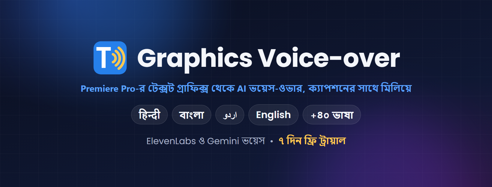

# Graphics Voice-over — Adobe Premiere Pro plugin

**Premiere Pro-র টেক্সট গ্রাফিক্স (ক্যাপশন) থেকে এক ক্লিকে AI ভয়েস-ওভার — প্রতিটা লাইন তার ক্যাপশনের সময়ে টাইমলাইনে বসে যায়।**

## ⬇️ ডাউনলোড / Download

### [Graphics-Voice-over.zip — সর্বশেষ ভার্সন (latest version)](https://github.com/ocpabdurrahim/graphics-voice-over/releases/latest/download/Graphics-Voice-over.zip)

৭ দিন ফ্রি ট্রায়াল • 7-day free trial
লাইসেন্স কিনতে / To buy a license: **WhatsApp 01912-007750 (+880 1912-007750)** ([chat](https://wa.me/8801912007750))

> শুধু উপরের লিংক থেকে ডাউনলোড করুন। "Source code" ফাইলগুলো প্লাগইন নয়।
> Download only the link above — the "Source code" files on the releases page are not the plugin.

---

## বাংলা

**যা করে**
- সিকোয়েন্সের সব টেক্সট গ্রাফিক্স (Type tool) পড়ে ভয়েস-ওভারের স্ক্রিপ্ট বানায়: প্রতিটা ক্যাপশন একটা লাইন
- একসাথে দেখানো লেখা (যেমন উপকরণের লিস্ট) একটা বাক্য হয়; টাইমার, লুকানো লেয়ার আর অন্য ভাষার লেখা বাদ যায়
- আপনার ElevenLabs ভয়েস দিয়ে (অথবা Gemini দিয়ে) প্রতিটা লাইনের ভয়েস বানায়: হিন্দি, উর্দু, বাংলা, ইংরেজি ও আরও ৪০+ ভাষা
- প্রতিটা লাইন তার ক্যাপশন শুরুর জায়গায় বসায়; লম্বা লাইন একটু দ্রুত করে (গলার স্বর একই থাকে), দুটো ভয়েস কখনো একসাথে বাজে না
- অরিজিনাল সাউন্ড মিউট করে, মিউজিক রাখে
- আগে স্ক্রিপ্ট দেখে নিন: যেকোনো লাইন এডিট করুন, শুনুন, আবার বানান
- আসল প্রজেক্ট নিরাপদ — ভয়েস-ওভার যায় নতুন একটা "… VO" প্রজেক্টে

অনুবাদ করা ভিডিওর জন্য বানানো: আগে ক্যাপশন অনুবাদ করুন ([Graphics Translator](https://github.com/ocpabdurrahim/graphics-translator) দিয়ে), তারপর এই প্যানেল সেগুলো পড়ে দেবে।

**যা লাগবে:** Windows • Adobe Premiere Pro 2023 বা নতুন • ইন্টারনেট • নিজের **ElevenLabs** অ্যাকাউন্ট ও API key (ভয়েসে আপনার প্ল্যানের ক্রেডিট খরচ হয়, প্রতি অক্ষরে প্রায় ১ ক্রেডিট) অথবা Gemini API key

**ইনস্টল**
1. zip ফাইলে রাইট ক্লিক > **Extract All** > Extract।
2. Premiere Pro বন্ধ করুন।
3. Extract করা ফোল্ডারে **Install.bat**-এ ডাবল ক্লিক, **Y** চাপুন।
   "Windows protected your PC" দেখালে: **More info > Run anyway**।
4. Premiere Pro-তে: **Window > Extensions > Graphics Voice-over**।

বিস্তারিত গাইড zip-এর ভেতরে: `README-Bangla.txt`।

**ট্রায়াল ও লাইসেন্স:** প্রথমবার খোলার দিন থেকে ৭ দিন সব ফ্রি। তারপর প্যানেলের Settings > License-এ নাম লিখে **Buy on WhatsApp** চাপুন (অথবা পিসি কোড কপি করে পাঠান): **01912-007750 (+880 1912-007750)**। আপনার পিসির জন্য লাইসেন্স কী পাবেন (লাইফটাইম, এক পিসি)। Graphics Translator-এর কী এই প্যানেলে চলে না; এর নিজের কী লাগে।

---

## English

**What it does**
- Reads every text graphic (Type tool) in a sequence and turns it into a voice-over script: one line per caption
- Text shown together (an ingredient list) becomes one sentence; timers, hidden layers and leftover text in another language are skipped
- Makes each line with your own ElevenLabs voices (or Gemini): Hindi, Urdu, Bangla, English and 40+ more languages
- Puts every line where its caption starts; long lines are sped up a little (same pitch), and voices never overlap
- Mutes the original sound and keeps the music
- Check the script first: edit, listen to and remake any line
- Your original project is never touched: the voice-over goes into a new "… VO" project

Made for translated videos: translate the captions first (with [Graphics Translator](https://github.com/ocpabdurrahim/graphics-translator)), then let this panel speak them.

**Needs:** Windows • Adobe Premiere Pro 2023 or newer • internet • your own **ElevenLabs** account and API key (the voice uses your plan's credits, about 1 credit per letter) or a Gemini API key

**Install**
1. Right-click the zip > **Extract All** > Extract.
2. Close Premiere Pro.
3. In the extracted folder, double-click **Install.bat** and press **Y**.
   If Windows says "Windows protected your PC": **More info > Run anyway**.
4. In Premiere Pro: **Window > Extensions > Graphics Voice-over**.

Full guide inside the zip: `README.txt`.

**Trial and license:** everything works for 7 days from the first time you open the panel. Then type your name in Settings > License and click **Buy on WhatsApp** (or send your PC code) to **01912-007750 (+880 1912-007750)** to buy a lifetime license for that PC. Graphics Translator keys do not unlock this panel; it has its own.
